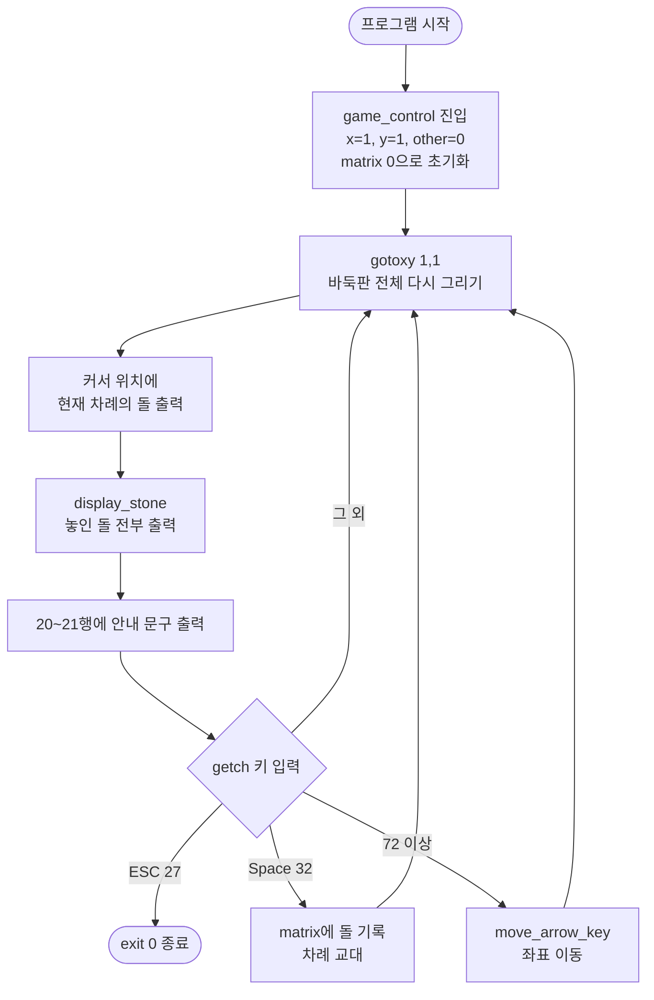

# 🎮 콘솔 바둑판 게임 — 원본 소스 코드 분석

> C언어와 Windows 콘솔 API로 만든 **19×19 바둑판 착수 프로그램**의 원본 코드를 분석한 문서입니다.
> 이후 진행할 업그레이드(바둑/오목 모드, 승패 판정 등)의 출발점을 정리하는 것이 목적입니다.

---

## 목차

1. [프로그램 개요](#1-프로그램-개요)
2. [실행 환경과 의존성](#2-실행-환경과-의존성)
3. [전체 구조](#3-전체-구조)
4. [실행 흐름](#4-실행-흐름)
5. [함수별 상세 분석](#5-함수별-상세-분석)
6. [자료구조와 좌표계](#6-자료구조와-좌표계)
7. [키 입력 처리 방식](#7-키-입력-처리-방식)
8. [바둑판 그리기 원리 (CP949 괘선 문자)](#8-바둑판-그리기-원리-cp949-괘선-문자)
9. [발견된 문제점과 버그](#9-발견된-문제점과-버그)
10. [원본 코드의 한계 요약](#10-원본-코드의-한계-요약)

---

## 1. 프로그램 개요

| 항목 | 내용 |
|---|---|
| 언어 | C (C89/C99 호환 문법) |
| 플랫폼 | Windows 콘솔 전용 |
| 판 크기 | 19 × 19 (바둑 정규 규격) |
| 플레이어 | 2인 (한 키보드를 번갈아 사용) |
| 돌 모양 | `○` (플레이어 0), `●` (플레이어 1) |
| 조작 | 방향키 이동, 스페이스바 착수, ESC 종료 |
| 승패 판정 | **없음** |

원본은 "게임"이라기보다 **바둑판 위에 커서를 움직여 두 사람이 번갈아 돌을 놓는 기능**까지만 구현되어 있습니다. 돌을 따내거나, 다섯 개를 이어 이기는 등의 규칙은 전혀 없습니다.

---

## 2. 실행 환경과 의존성

```c
#include <stdio.h>    // printf
#include <stdlib.h>   // exit
#include <conio.h>    // getch      (비표준, Windows/DOS 계열 전용)
#include <windows.h>  // SetConsoleCursorPosition, COORD, GetStdHandle
```

| 헤더 | 사용 기능 | 비고 |
|---|---|---|
| `stdio.h` | `printf` | 표준 |
| `stdlib.h` | `exit` | 표준 |
| `conio.h` | `getch` | **비표준**. MSVC에서는 `_getch` 권장 (경고 C4996 발생 가능) |
| `windows.h` | 커서 위치 이동 | Windows 전용 |

### ⚠️ 문자 인코딩 의존성

- 바둑판 괘선과 돌(`○`, `●`)을 **CP949(EUC-KR) 2바이트 문자**로 출력합니다.
- 소스 파일이 **CP949로 저장**되어 있고, 콘솔 코드 페이지가 **949**일 때만 정상 표시됩니다.
- 소스를 UTF-8로 저장하거나, 콘솔이 UTF-8(코드 페이지 65001)이면 판이 깨집니다.

---

## 3. 전체 구조

```
main()
 └─ game_control()            ← 게임 루프 전체
     ├─ gotoxy()              ← 커서 위치 이동
     ├─ draw_check01()        ← 바둑판 출력
     ├─ display_stone()       ← 놓인 돌 출력
     │   └─ gotoxy()
     └─ move_arrow_key()      ← 방향키에 따른 좌표 이동
```

| 함수 | 역할 | 반환 |
|---|---|---|
| `main` | `game_control()` 호출 후 종료 | `int` |
| `gotoxy(x, y)` | 콘솔 커서를 (x, y)로 이동 (1부터 시작) | `void` |
| `draw_check01(c, r)` | 가로 c칸, 세로 r칸의 바둑판을 괘선 문자로 출력 | `void` |
| `game_control()` | 입력 → 처리 → 출력의 메인 루프 | `void` |
| `display_stone(matrix)` | 배열에 기록된 모든 돌을 화면에 출력 | `void` |
| `move_arrow_key(key, &x, &y, x_b, y_b)` | 방향키 값에 따라 좌표를 경계 안에서 변경 | `void` |

---

## 4. 실행 흐름



**특징:** 키를 하나 누를 때마다 **바둑판 → 커서 → 돌 → 안내문**을 처음부터 전부 다시 그립니다.

---

## 5. 함수별 상세 분석

### 5.1 `main`

```c
int main(void)
{
    game_control();
    return 0;
}
```

- 게임 루프 함수만 호출합니다.
- 실제 종료는 `game_control` 안의 `exit(0)`에서 일어나므로, `return 0`에는 도달하지 않습니다.

---

### 5.2 `gotoxy`

```c
void gotoxy(int x, int y)
{
   COORD Pos = {x - 1, y - 1};
   SetConsoleCursorPosition(GetStdHandle(STD_OUTPUT_HANDLE), Pos);
}
```

- Windows 콘솔 좌표는 **0부터** 시작하지만, 이 함수는 **1부터** 시작하는 좌표를 받아 1씩 빼서 변환합니다.
- 화면 좌상단 = `(1, 1)`.
- `x`는 **열(가로, 문자 칸)**, `y`는 **행(세로, 줄)**입니다.
- 매 호출마다 `GetStdHandle`을 부르는데, 성능상 문제는 없지만 핸들을 한 번만 얻어 재사용하는 편이 깔끔합니다.

---

### 5.3 `draw_check01`

```c
void draw_check01(int c, int r)
{
    int i, j;
    unsigned char a=0xa6;
    unsigned char b[12];
    for(i=1;i<12;i++)
        b[i]=0xa0+i;
    ...
}
```

- CP949 괘선 문자를 **바이트 단위로 조합**해서 출력합니다. (선두 바이트 `0xA6` + 후속 바이트 `0xA1~0xAB`)
- `b[1]~b[11]`만 초기화하고, `b[0]`은 쓰지 않습니다.
- 출력 구조는 다음과 같습니다.

| 구간 | 출력 | 반복 |
|---|---|---|
| 맨 윗줄 | `┌` + `┬` × (c−1) + `┐` | 1줄 |
| 중간줄 | `├` + `┼` × (c−1) + `┤` | (r−1)줄 |
| 맨 아랫줄 | `└` + `┴` × (c−1) + `┘` | 1줄 |

- `draw_check01(18, 18)`로 호출하므로 **가로 19개 × 세로 19개의 교차점**, 즉 19×19 바둑판이 그려집니다.
  - 매개변수 `c`, `r`은 교차점 수가 아니라 **칸(사이 공간) 수**입니다.
- 문자 하나가 전각(2칸 폭)이므로 판은 **가로 38열 × 세로 19줄**을 차지합니다.

자세한 문자표는 [8장](#8-바둑판-그리기-원리-cp949-괘선-문자)에 있습니다.

---

### 5.4 `game_control` (메인 루프)

```c
void game_control(void)
{
   int x=1, y=1, other=0;
   int matrix[2][20][20]={0};
   char key;
   char *stone[2]={"○","●"};
   do
   {
       gotoxy(1,1);
       draw_check01(18, 18);          // ① 판 다시 그리기
       gotoxy(x, y);
       printf("%s", stone[other]);    // ② 커서 위치에 현재 차례 돌 표시
       display_stone(matrix);         // ③ 놓인 돌 표시
       gotoxy(1, 20);
       printf("방향키로 움직이고 ");
       printf("스페이스 키를 누르시오.");
       gotoxy(1,21);
       printf("돌을 놓았으면 상대방 차례입니다. ");
       key=getch();                   // ④ 입력 대기
       if (key==27)                   // ESC
           exit(0);
       else if(key==32)               // Space
       {
           matrix[other][(x+1)/2][y]=1;
           other=1-other;
       }
       else if (key>=72)              // 방향키(로 간주)
           move_arrow_key(key, &x, &y, 37, 19);
   }while(1);
}
```

#### 지역 변수

| 변수 | 의미 | 초기값 |
|---|---|---|
| `x` | 커서의 **화면 열** 좌표 (1, 3, 5, …, 37) | 1 |
| `y` | 커서의 **화면 행** 좌표 (1 ~ 19) | 1 |
| `other` | 현재 차례 (0 = `○`, 1 = `●`) | 0 |
| `matrix[2][20][20]` | 플레이어별 착수 기록 | 전부 0 |
| `key` | 입력된 키 값 | – |
| `stone[2]` | 돌 문자열 | `"○"`, `"●"` |

#### 동작 요약

- **커서 표시:** 별도의 커서 모양 없이, **현재 차례의 돌**을 커서 위치에 그려서 "여기에 둘 수 있다"는 것을 표현합니다. 돌 모양으로 누구 차례인지도 알 수 있습니다.
- **착수:** 화면 좌표 `(x, y)`를 배열 인덱스 `[(x+1)/2][y]`로 바꿔서 `1`을 기록하고, `other = 1 - other`로 차례를 교대합니다. (원본 주석: `//수정한 부분(획인)`)
- **그리기 순서:** 커서 돌 → 놓인 돌 순서이므로, 이미 돌이 있는 칸 위에 커서가 있으면 **놓인 돌이 커서를 덮어** 커서가 보이지 않습니다.
- **종료:** 무한 루프(`do { } while(1)`)이며, ESC를 누를 때 `exit(0)`으로만 빠져나옵니다.

---

### 5.5 `display_stone`

```c
void display_stone(int matrix[][20][20])
{
    int i, x, y;
    char *stone[2]={"○", "●"};

    for(i=0;i<2;i++)
        for(x=1;x<20;x++)
            for(y=1;y<20;y++)
                if (matrix[i][x][y]==1)
                {
                    gotoxy(x*2-1, y);
                    printf("%s", stone[i]);
                }
}
```

- 두 플레이어 층을 모두 순회하면서 `1`인 칸에 돌을 찍습니다.
- 배열 인덱스 `x`(1~19)를 화면 열 `x*2-1`(1~37)로 되돌립니다. → `game_control`의 `(x+1)/2`와 **정확히 역변환** 관계입니다.
- 인덱스 `0`은 사용하지 않습니다 (1~19만 사용).
- 매 프레임 19 × 19 × 2 = **722칸**을 전부 검사합니다.
- `stone` 배열이 `game_control`에도 똑같이 선언되어 있어 **중복**입니다.

---

### 5.6 `move_arrow_key`

```c
void move_arrow_key(char key, int *x1, int *y1, int x_b, int y_b)
{
    switch(key)
    {
    case 72: *y1=*y1-1; if (*y1<1)   *y1=1;   break;  // ↑
    case 75: *x1=*x1-2; if (*x1<1)   *x1=1;   break;  // ←
    case 77: *x1=*x1+2; if (*x1>x_b) *x1=x_b; break;  // →
    case 80: *y1=*y1+1; if (*y1>y_b) *y1=y_b; break;  // ↓
    default: return;
    }
}
```

- 포인터로 좌표를 받아 직접 수정합니다 (Call by Reference).
- **가로는 2씩**, 세로는 1씩 움직입니다. 바둑판 문자가 전각(2칸 폭)이기 때문입니다.
- 경계값: `x`는 1 ~ `x_b`(37), `y`는 1 ~ `y_b`(19). 경계를 넘으면 그 자리에 고정됩니다 (반대편으로 넘어가지 않음).
- 프로토타입에서는 첫 매개변수 이름이 `chr`, 정의에서는 `key`로 서로 다르지만 C에서는 문제가 되지 않습니다.

---

## 6. 자료구조와 좌표계

### 6.1 착수 배열

```c
int matrix[2][20][20];
//         │   │   └─ 세로 인덱스 (1~19 사용)
//         │   └───── 가로 인덱스 (1~19 사용)
//         └───────── 플레이어 (0 = ○, 1 = ●)
```

- 플레이어마다 **별도의 19×19 판**을 두는 구조입니다.
- 값은 `0`(빈 칸) 또는 `1`(돌 있음)만 씁니다.
- 한 칸의 상태를 알려면 두 층을 모두 확인해야 합니다.
- 업그레이드 시에는 `board[19][19]` 하나에 `0=빈칸, 1=흑, 2=백`처럼 저장하는 편이 승리 판정·따내기 구현에 훨씬 편합니다.

### 6.2 화면 좌표 ↔ 배열 인덱스

| 구분 | 가로 | 세로 |
|---|---|---|
| 화면 좌표 (`gotoxy`) | 1, 3, 5, …, 37 (홀수만) | 1 ~ 19 |
| 배열 인덱스 | 1 ~ 19 | 1 ~ 19 |
| 화면 → 배열 | `(x + 1) / 2` | `y` |
| 배열 → 화면 | `x * 2 - 1` | `y` |

```
화면 열:  1  3  5  7 ...  37
          ┌─┬─┬─┬─ ... ─┐      ← 1행
          ├─┼─┼─┼─ ... ─┤      ← 2행
배열 x:   1  2  3  4 ...  19
```

### 6.3 화면 배치

| 행 | 내용 |
|---|---|
| 1 ~ 19 | 바둑판 (가로 38열) |
| 20 | `방향키로 움직이고 스페이스 키를 누르시오.` |
| 21 | `돌을 놓았으면 상대방 차례입니다.` |

---

## 7. 키 입력 처리 방식

### 7.1 Windows 콘솔의 방향키

`getch()`로 방향키를 누르면 값이 **두 번** 들어옵니다.

| 키 | 1번째 값 | 2번째 값 |
|---|---|---|
| ↑ | 224 (0xE0) | 72 |
| ← | 224 (0xE0) | 75 |
| → | 224 (0xE0) | 77 |
| ↓ | 224 (0xE0) | 80 |

### 7.2 원본 코드가 이를 처리하는 방식

- `key`가 `char`(대부분 컴파일러에서 signed)이므로 224는 **−32**로 저장됩니다.
- −32는 27도, 32도, 72 이상도 아니므로 **아무 동작 없이 무시**되고, 루프가 한 번 더 돌면서 판을 다시 그립니다.
- 다음 `getch()`에서 72/75/77/80이 들어와 이동이 처리됩니다.
- 즉, **의도한 설계라기보다 우연히 동작하는 구조**입니다.

### 7.3 부작용

`key >= 72` 조건 때문에 **일반 문자 키도 방향키로 인식**됩니다.

| 누른 키 | ASCII | 결과 |
|---|---|---|
| `H` | 72 | 위로 이동 |
| `K` | 75 | 왼쪽으로 이동 |
| `M` | 77 | 오른쪽으로 이동 |
| `P` | 80 | 아래로 이동 |
| 그 밖의 72 이상 문자 | – | `default`로 빠져 무시 |

---

## 8. 바둑판 그리기 원리 (CP949 괘선 문자)

CP949(KS X 1001)에서 괘선 문자는 선두 바이트 `0xA6`에 후속 바이트를 붙여 표현합니다.

| 코드 내 표현 | 바이트 | 문자 | 원본에서 사용 |
|---|---|---|---|
| `b[1]` | A6 A1 | `─` | ✗ |
| `b[2]` | A6 A2 | `│` | ✗ |
| `b[3]` | A6 A3 | `┌` | 좌상단 모서리 |
| `b[4]` | A6 A4 | `┐` | 우상단 모서리 |
| `b[5]` | A6 A5 | `┘` | 우하단 모서리 |
| `b[6]` | A6 A6 | `└` | 좌하단 모서리 |
| `b[7]` | A6 A7 | `├` | 왼쪽 변 |
| `b[8]` | A6 A8 | `┬` | 윗변 |
| `b[9]` | A6 A9 | `┤` | 오른쪽 변 |
| `b[10]` | A6 AA | `┴` | 아랫변 |
| `b[11]` | A6 AB | `┼` | 내부 교차점 |

`printf("%c%c", a, b[n])`처럼 두 바이트를 연달아 찍으면 콘솔이 이를 한 글자로 조합해 보여 줍니다.
돌 문자 `○`(A1 DB)와 `●`(A1 DC)도 같은 CP949 전각 문자라 괘선과 폭(2칸)이 정확히 맞습니다.

### 출력 예 (축소)

```
┌┬┬┬┬┐
├┼┼┼┼┤
├┼○┼┼┤
├┼┼●┼┤
└┴┴┴┴┘
```

---

## 9. 발견된 문제점과 버그

### 9.1 기능 버그

| # | 문제 | 원인 | 영향 |
|---|---|---|---|
| B1 | **이미 돌이 있는 자리에 또 둘 수 있음** | 착수 전 빈 칸 검사 없음 | 같은 칸에 두 층 모두 `1`이 될 수 있고, 화면에는 나중에 그려지는 `●`만 보임 |
| B2 | **문자 키로 커서가 움직임** | `key >= 72` 조건 | `H`, `K`, `M`, `P` 입력 시 이동 |
| B3 | **방향키 처리가 우연에 의존** | 확장 키 접두값(224)을 처리하지 않음 | 방향키 1회당 불필요한 화면 재출력 1회 발생 |
| B4 | **백(○)이 먼저 둠** | `other=0`이 `○` | 바둑·오목 모두 흑이 먼저 두는 관례와 반대 |
| B5 | **승패 판정 없음** | 미구현 | 게임이 끝나지 않음 |

### 9.2 화면/사용성 문제

| # | 문제 | 원인 |
|---|---|---|
| U1 | **화면 깜빡임** | 키 입력마다 바둑판 전체(19줄)를 다시 출력 |
| U2 | 콘솔 커서(밑줄)가 깜빡이며 보임 | 커서 숨김 처리 없음 |
| U3 | 돌 위에 커서가 있으면 커서가 안 보임 | 커서 → 돌 순서로 그림 |
| U4 | 누구 차례인지 글로 표시되지 않음 | 커서 돌 모양으로만 구분 |
| U5 | 좌표 표시(가로/세로 번호) 없음 | 미구현 |
| U6 | 화점(별) 표시 없음 | 미구현 |
| U7 | 무르기, 다시 시작, 패스 기능 없음 | 미구현 |
| U8 | 시작 화면·종료 화면 없음 | 실행 즉시 판이 뜨고 ESC로 바로 꺼짐 |

### 9.3 코드 품질

| # | 문제 | 개선 방향 |
|---|---|---|
| Q1 | 매직 넘버 다수 (`18`, `19`, `37`, `27`, `32`, `72` …) | `#define BOARD_SIZE 19`, `#define KEY_ESC 27` 등 상수화 |
| Q2 | `stone` 배열 중복 선언 | 전역 상수 또는 한 곳에서 관리 |
| Q3 | `getch()` 반환값(`int`)을 `char`에 저장 | `int key`로 받기 |
| Q4 | 플레이어별 3차원 배열 | `board[19][19]` 단일 배열 + 상태값 |
| Q5 | 비표준 `getch` | MSVC에서는 `_getch` 사용 |
| Q6 | CP949 인코딩 의존 | 실행 환경 명시 또는 `SetConsoleOutputCP` 지정 |
| Q7 | 들여쓰기 혼재 (탭/공백) | 스타일 통일 |
| Q8 | 주석 오타 `획인` | `확인` |
| Q9 | `exit(0)`로 루프 탈출 | 플래그나 `return`으로 정상 종료 흐름 구성 |

---

## 10. 원본 코드의 한계 요약

원본 코드는 다음 세 가지를 **잘 해내고 있습니다.**

- ✅ Windows 콘솔 API로 커서를 원하는 위치에 옮기는 법
- ✅ CP949 괘선 문자를 바이트 단위로 조합해 바둑판을 그리는 법
- ✅ 화면 좌표와 배열 인덱스를 변환해 돌을 저장·표시하는 법

반면, "게임"이 되기 위해 필요한 요소는 대부분 빠져 있습니다.

- ❌ 게임 규칙 (바둑의 따내기·계가, 오목의 5목 판정)
- ❌ 승패와 종료 처리
- ❌ 잘못된 착수 방지
- ❌ 시작 화면, 메뉴, 결과 화면
- ❌ 깜빡임 없는 화면 갱신

이후 업그레이드는 이 부족한 부분을 채우는 방향으로 진행합니다.
