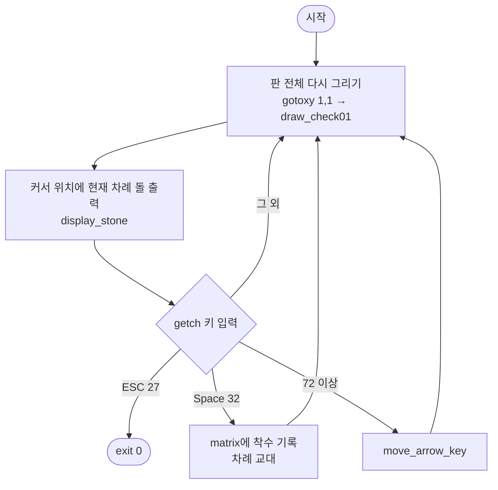
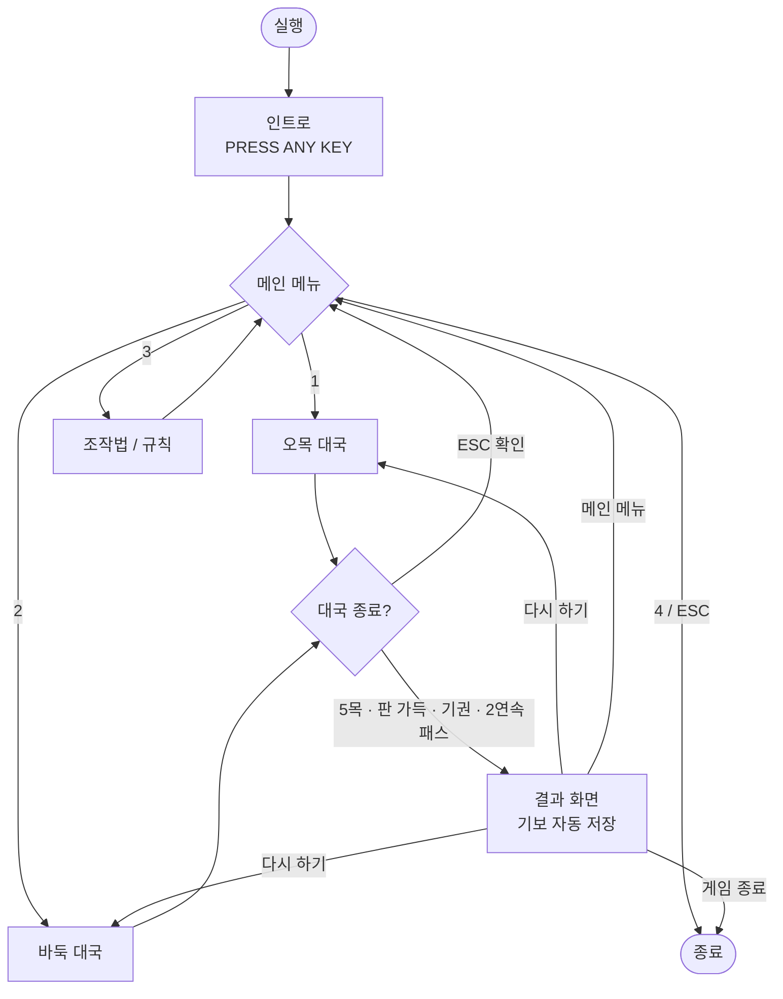

# ⚫⚪ 게임프로그래밍 — C언어 기반 코드 업그레이드

> **원본 코드 `8_1_3`** (19×19 콘솔 바둑판 착수 프로그램)을 분석하고,
> **바둑과 오목을 모두 즐길 수 있는 콘솔 게임 v2.0**으로 업그레이드한 프로젝트입니다.

| 항목 | 내용 |
|---|---|
| 작성자 | 송동욱 |
| 과목 | 게임프로그래밍 |
| 언어 · 환경 | C · Windows 콘솔 (Visual Studio / MinGW) |
| 원본 | `8_1_3.c` — 123줄 · 함수 6개 |
| 업그레이드 | `baduk_omok.c` — 1,123줄 · 함수 42개 |
| 업그레이드 항목 | **35개** |
| 최종 점수 | **30 / 30** |

---

## 📑 목차

1. [저장소 구성](#1-저장소-구성)
2. [원본 코드 8_1_3](#2-원본-코드-8_1_3)
3. [원본 코드 분석](#3-원본-코드-분석)
4. [업그레이드 개요](#4-업그레이드-개요)
5. [세부 업그레이드 내용](#5-세부-업그레이드-내용)
6. [업그레이드 항목 총정리 (35개)](#6-업그레이드-항목-총정리-35개)
7. [게임 사용법](#7-게임-사용법)
8. [빌드 및 실행 방법](#8-빌드-및-실행-방법)
9. [테스트 내역](#9-테스트-내역)
10. [알려진 제한 사항](#10-알려진-제한-사항)
11. [발표 자료 구성](#11-발표-자료-구성)
12. [최종 점수](#12-최종-점수)

---

## 1. 저장소 구성

| 파일 | 설명 |
|---|---|
| `8_1_3.c` | 원본 소스 코드 |
| `baduk_omok.c` | 업그레이드 소스 (**CP949**, 컴파일용) |
| `baduk_omok_utf8.c` | 업그레이드 소스 (UTF-8, GitHub 열람용 — 내용 동일) |
| `게임프로그래밍_C언어_코드업그레이드_송동욱.pptx` | 발표 자료 (20장) |
| `README.md` | 이 문서 |

---

## 2. 원본 코드 8_1_3

### 2.1 개요

| 항목 | 내용 |
|---|---|
| 파일명 | `8_1_3.c` |
| 언어 · 환경 | C 언어 · Windows 콘솔 (`conio.h`, `windows.h`) |
| 기능 | 19×19 바둑판을 그리고 두 사람이 번갈아 돌을 놓음 |
| 조작 | 방향키 이동 · Space 착수 · ESC 종료 |
| 한계 | **승패 판정이 없어 돌 놓기만 가능** |

원본은 "게임"이라기보다 **바둑판 위에 커서를 움직여 두 사람이 번갈아 돌을 놓는 기능**까지만 구현되어 있습니다.

### 2.2 원본 소스

<details>
<summary>8_1_3.c 전체 코드 펼치기 (123줄)</summary>

```c
#include <stdio.h>
#include <stdlib.h>
#include <conio.h>
#include <windows.h>

void move_arrow_key(char chr, int *x, int *y, int x_b, int y_b);
void gotoxy(int x, int y);
void draw_check01(int c, int r);
void game_control(void);
void display_stone(int matrix[][20][20]);

int main(void)
{
	game_control();
	return 0;
}


void gotoxy(int x, int y)
{
   COORD Pos = {x - 1, y - 1};
   SetConsoleCursorPosition(GetStdHandle(STD_OUTPUT_HANDLE), Pos);
}

void draw_check01(int c, int r)
{
    int i, j;
    unsigned char a=0xa6;
    unsigned char b[12]; 
    for(i=1;i<12;i++)
	b[i]=0xa0+i;
    printf("%c%c",a, b[3]);
    for(i=0;i<c-1;i++)
	 printf("%c%c", a, b[8]);
    printf("%c%c", a, b[4]);
    printf("\n");
    for(i=0;i<r-1;i++)
    {
	printf("%c%c", a, b[7]);
	for(j=0;j<c-1;j++)
	    printf("%c%c", a, b[11]);
	printf("%c%c",a, b[9]);
	printf("\n");
    }
    printf("%c%c", a, b[6]);
    for(i=0;i<c-1;i++)
	printf("%c%c", a, b[10]);
    printf("%c%c", a, b[5]);
    printf("\n");
}

void game_control(void)
{
   int x=1, y=1, other=0; 
   int matrix[2][20][20]={0};
   char key;
   char *stone[2]={"○","●"};
   do
   {
	gotoxy(1,1);
	draw_check01(18, 18);
	gotoxy(x, y);
	printf("%s", stone[other]);
	display_stone(matrix);
	gotoxy(1, 20);
	printf("방향키로 움직이고 ");
	printf("스페이스 키를 누르시오.");
	gotoxy(1,21);
        printf("돌을 놓았으면 상대방 차례입니다. ");
	key=getch();
	if (key==27)
		exit(0);
	else if(key==32)
	{
		matrix[other][(x+1)/2][y]=1;
                other=1-other;  //수정한 부분(획인)
	}
	else if (key>=72)
		move_arrow_key(key, &x, &y, 37, 19);
   }while(1);
}

void display_stone(int matrix[][20][20])
{
	int i, x, y;
	char  *stone[2]={"○", "●"};

	for(i=0;i<2;i++)
		for(x=1;x<20;x++)
			for(y=1;y<20;y++)
			{
				if (matrix[i][x][y]==1)
				{
					gotoxy(x*2-1, y);
					printf("%s", stone[i]);
				}
			}
}

void move_arrow_key(char key, int *x1, int *y1, int x_b, int y_b)
{
	switch(key)
	{
	case 72:  //위쪽(상) 방향의 화살표 키 입력
		*y1=*y1-1;
		if (*y1<1)	*y1=1; //y좌표의 최소값
		break;
	case 75:  //왼쪽(좌) 방향의 화살표 키 입력
		*x1=*x1-2;             //좌측방향으로 2씩 감소
		if (*x1<1)	*x1=1; //x좌표의 최소값
		break;
	case 77:  //오른쪽(우) 방향의 화살표 키 입력
		*x1=*x1+2;               //우측방향으로 2씩 증가
		if (*x1>x_b)  *x1=x_b; //x좌표의 최대값(경계)
		break;
	case 80:  //아래쪽(하) 방향의 화살표 키 입력
		*y1=*y1+1;
		if (*y1>y_b)  *y1=y_b; //y좌표의 최대값(경계)
		break;
	default:
		return;
	}
}
```

</details>

---

## 3. 원본 코드 분석

### 3.1 함수 구조

```
main()
 └─ game_control()            ← 게임 루프 전체
     ├─ gotoxy()              ← 콘솔 커서 이동
     ├─ draw_check01()        ← 바둑판 괘선 출력
     ├─ display_stone()       ← 놓인 돌 전부 출력
     └─ move_arrow_key()      ← 방향키로 좌표 이동
```

| 함수 | 역할 |
|---|---|
| `main` | `game_control()` 호출. 실제 종료는 `exit(0)`에서 일어나 `return 0`에는 도달하지 않음 |
| `gotoxy(x, y)` | 1부터 시작하는 좌표를 받아 콘솔 커서를 이동 |
| `draw_check01(c, r)` | CP949 괘선 문자로 c×r **칸**짜리 판을 출력 (`18, 18` → 교차점 19×19) |
| `game_control()` | 입력 → 처리 → 출력의 무한 루프 |
| `display_stone(matrix)` | 배열에 기록된 돌을 모두 화면에 출력 |
| `move_arrow_key(...)` | 방향키 값에 따라 좌표를 경계 안에서 변경 (가로 2칸, 세로 1칸) |

### 3.2 게임 루프



### 3.3 핵심 원리

| 원리 | 내용 |
|---|---|
| **좌표 변환** | 배열 x = `(화면 x + 1) / 2`, 화면 x = `배열 x * 2 - 1`. 바둑판 문자가 전각(2칸 폭)이라 가로는 2칸씩 이동 |
| **CP949 괘선 문자** | 선두 바이트 `0xA6` + 후속 바이트 `0xA1~0xAB`를 연달아 찍어 `┌ ┬ ┐ ├ ┼ ┤ └ ┴ ┘` 출력 |
| **착수 기록** | `matrix[2][20][20]` — 플레이어별로 19×19 판을 따로 두고 놓은 자리를 `1`로 기록 (인덱스 0은 미사용) |
| **방향키 입력** | `getch()`는 방향키에 `224` → `72/75/77/80` 두 값을 돌려줌. 원본은 첫 값(−32로 저장됨)을 우연히 무시하는 방식으로 동작 |

<details>
<summary>CP949 괘선 문자표</summary>

| 코드 | 바이트 | 문자 | 용도 |
|---|---|---|---|
| `b[3]` | A6 A3 | `┌` | 좌상단 |
| `b[4]` | A6 A4 | `┐` | 우상단 |
| `b[5]` | A6 A5 | `┘` | 우하단 |
| `b[6]` | A6 A6 | `└` | 좌하단 |
| `b[7]` | A6 A7 | `├` | 왼쪽 변 |
| `b[8]` | A6 A8 | `┬` | 윗변 |
| `b[9]` | A6 A9 | `┤` | 오른쪽 변 |
| `b[10]` | A6 AA | `┴` | 아랫변 |
| `b[11]` | A6 AB | `┼` | 내부 교차점 |

</details>

### 3.4 문제점

| 기능 버그 | 화면 · 사용성 | 코드 품질 |
|---|---|---|
| 이미 돌이 있는 자리에 또 둘 수 있음 | 키 입력마다 판 전체를 다시 그려 **깜빡임** | `18`, `37`, `72` 같은 매직 넘버 |
| `H`·`K`·`M`·`P` 키로도 커서가 움직임 (`key >= 72`) | 콘솔 커서(밑줄)가 그대로 보임 | 플레이어별 3차원 배열로 판 관리 |
| 방향키 확장 코드(224)를 처리하지 않음 | 누구 차례인지 글로 표시되지 않음 | `getch()` 결과(`int`)를 `char`에 저장 |
| 백(○)이 먼저 둠 | 좌표 · 화점 표시 없음 | `stone` 배열 중복 선언 |
| **승패 판정이 없어 끝나지 않음** | 시작 · 결과 화면, 무르기 없음 | `exit(0)`으로 루프 탈출 |

> 돌만 놓을 수 있는 **"바둑판"** → 승패가 있는 **"게임"**으로 업그레이드합니다.

---

## 4. 업그레이드 개요

### 4.1 원본 vs 업그레이드

| 구분 | 원본 8_1_3 | 업그레이드 v2.0 |
|---|---|---|
| 게임 종류 | 착수만 가능 | **오목 / 바둑** 선택 |
| 승패 판정 | 없음 | 오목 5목 판정 · 바둑 따내기와 계가 |
| 시작 · 종료 | 실행 즉시 판, ESC로 바로 종료 | 인트로 → 메뉴 → 결과 화면 → 다시하기 |
| 화면 갱신 | 입력마다 판 전체 재출력 (깜빡임) | **바뀐 칸만** 다시 그림 (깜빡임 없음) |
| 잘못된 착수 | 돌 위에 겹쳐 놓기 가능 | 중복 · 자충수 · 패 금지 |
| 편의 기능 | 없음 | 무르기 · 패스 · 기권 · 기보 저장 · 효과음 |
| 코드 규모 | 123줄 · 함수 6개 | **1,123줄 · 함수 42개** |

### 4.2 화면 흐름



### 4.3 코드 구조

```
main
 ├─ setup_console        코드 페이지, 창 제목, 폰트, 창 크기, 커서 숨김
 ├─ show_intro           배너 + PRESS ANY KEY
 └─ main_menu ── select_menu
     ├─ show_help
     └─ play_game ─────────────────────────── 대국 루프
         ├─ init_game / redraw_all
         ├─ refresh_board ── cell_visual, draw_cell, grid_char
         ├─ draw_panel ── panel_line, coord_str
         ├─ get_key
         ├─ play_omok ── check_omok
         ├─ play_go ── collect_group
         ├─ do_pass ── score_go
         ├─ do_undo / push_history
         ├─ confirm
         └─ show_result ── save_kifu, select_menu
```

게임의 모든 상태를 구조체 하나에 담고, 원본의 `matrix[2][20][20]`을 `board[19][19]` 하나로 합쳤습니다.

```c
typedef struct {
    int board[N][N];        /* board[y][x] = EMPTY / BLACK / WHITE */
    int turn;               /* 현재 차례 */
    int moveNo;             /* 지금까지 진행된 수 (패스 포함) */
    int captured[3];        /* captured[c] = c 가 따낸 돌 수 */
    int lastX, lastY;       /* 마지막 착수 위치 (-1 = 없음) */
    int koX, koY;           /* 패로 금지된 자리 (-1 = 없음) */
    int passCount;          /* 연속 패스 횟수 */
} GameState;
```

| 구분 | 원본 | v2.0 |
|---|---|---|
| 커서 좌표 | 화면 열 (1, 3, …, 37) | 배열 인덱스 (0~18) |
| 화면 변환 | `(x+1)/2`, `x*2-1` | `BOARD_X + x*2`, `BOARD_Y + y` |
| 판 배열 | `matrix[2][20][20]` (인덱스 1~19) | `board[19][19]` (0=빈칸, 1=흑, 2=백) |

---

## 5. 세부 업그레이드 내용

> 아래 코드는 `baduk_omok.c`에서 발췌한 것입니다.

### ① 인트로와 메뉴로 게임 흐름 만들기 — `01` ~ `05`

```c
int main(void)
{
    int choice, act = ACT_MENU;

    setup_console();
    show_intro();

    while (1) {
        choice = main_menu();
        if (choice == 0 || choice == 1) {
            int mode = (choice == 0) ? MODE_OMOK : MODE_GO;
            do {
                act = play_game(mode);
            } while (act == ACT_RESTART);
            if (act == ACT_QUIT) break;
        }
        else if (choice == 2) {
            show_help();
        }
        else {
            break;
        }
    }
    ...
}
```

| # | 항목 | 설명 |
|:-:|---|---|
| 01 | 인트로 타이틀 화면 | `■` 문자로 그린 BADUK & OMOK 배너와 깜빡이는 PRESS ANY KEY |
| 02 | 오목 / 바둑 선택 메뉴 | 방향키나 숫자키로 오목 · 바둑 · 조작법 · 종료 선택 |
| 03 | 조작법 · 규칙 도움말 | 메뉴나 대국 중 `H` 키로 언제든 열람 |
| 04 | 다시하기 · 메인메뉴 · 종료 | 대국이 끝나면 결과 화면에서 다음 행동 선택 |
| 05 | 창 제목 · 크기 설정 | 창 제목 "콘솔 바둑 & 오목 v2.0", 90 × 32 창 크기 자동 설정 |

### ② 오목 승리 규칙 구현 — `06` ~ `09`

방금 놓은 돌에서 4방향(→ ↓ ↘ ↗)마다 반대쪽 끝을 찾은 뒤 정방향으로 같은 색을 셉니다.

```c
int check_omok(int x, int y)
{
    static const int dx[4] = { 1, 0, 1, 1 };
    static const int dy[4] = { 0, 1, 1, -1 };
    int color = g.board[y][x];
    int d, k, cnt, sx, sy;

    for (d = 0; d < 4; d++) {
        /* 뒤쪽 끝 찾기 */
        sx = x; sy = y;
        while (sx - dx[d] >= 0 && sx - dx[d] < N && sy - dy[d] >= 0 && sy - dy[d] < N
               && g.board[sy - dy[d]][sx - dx[d]] == color) {
            sx -= dx[d];
            sy -= dy[d];
        }
        /* 앞쪽으로 세기 */
        cnt = 0;
        while (sx + dx[d] * cnt >= 0 && sx + dx[d] * cnt < N &&
               sy + dy[d] * cnt >= 0 && sy + dy[d] * cnt < N &&
               g.board[sy + dy[d] * cnt][sx + dx[d] * cnt] == color) {
            cnt++;
        }
        if (cnt == 5) {                         /* 정확히 5개 : 장목 제외 */
            for (k = 0; k < 5; k++)
                winMark[sy + dy[d] * k][sx + dx[d] * k] = 1;
            return 1;
        }
    }
    return 0;
}
```

| # | 항목 | 설명 |
|:-:|---|---|
| 06 | 5목 승리 판정 | 가로 · 세로 · 대각선 2방향, 총 4방향 검사 |
| 07 | 장목 불인정 | `cnt == 5`일 때만 승리 — 6목 이상은 인정하지 않음 |
| 08 | 승리 5목 하이라이트 | `winMark`에 기록해 이긴 5개 돌을 연두색 배경으로 표시 |
| 09 | 무승부 판정 | 361칸이 모두 차면 무승부로 종료 |

### ③ 바둑 규칙 ① 따내기 · 자충수 · 패 — `10` ~ `12`

```c
    if (g.board[y][x] != EMPTY)    return ERR_OCCUPIED;
    if (x == g.koX && y == g.koY)  return ERR_KO;

    g.board[y][x] = me;

    /* 1) 이웃한 상대 무리 중 활로가 0이 된 것을 따냄 */
    for (i = 0; i < 4; i++) {
        nx = x + DX[i];
        ny = y + DY[i];
        if (nx < 0 || ny < 0 || nx >= N || ny >= N) continue;
        if (g.board[ny][nx] != op) continue;

        libs = collect_group(nx, ny, gx, gy, &size);
        if (libs == 0) {
            for (k = 0; k < size; k++) g.board[gy[k]][gx[k]] = EMPTY;
            total += size;
            capX = gx[0];
            capY = gy[0];
        }
    }

    /* 2) 내 무리의 활로가 0이면 자충수 (호출한 쪽에서 상태 복원) */
    libs = collect_group(x, y, gx, gy, &size);
    if (libs == 0) return ERR_SUICIDE;

    /* 3) 패 : 한 점을 따냈고, 놓은 돌이 홀로 활로 1개뿐이면 그 자리를 금지 */
    if (total == 1 && size == 1 && libs == 1) {
        g.koX = capX;
        g.koY = capY;
    } else {
        g.koX = g.koY = -1;
    }
```

`collect_group()`은 스택을 이용한 DFS로 같은 색 무리를 모으고, 이웃한 빈 칸(활로)을 중복 없이 셉니다.

| # | 항목 | 설명 |
|:-:|---|---|
| 10 | 돌 따내기 | 이웃한 상대 무리의 활로가 0이면 판에서 제거 |
| 11 | 자충수 금지 | 상대를 따내지 못하고 내 무리 활로가 0이면 착수 취소 |
| 12 | 패(ko) 규칙 | 한 점을 따낸 직후 그 자리를 상대가 곧바로 되따낼 수 없음 |

### ④ 바둑 규칙 ② 패스 · 계가 · 기권 — `13` ~ `16`

```c
void do_pass(void)
{
    GameState before = g;

    g.passCount++;
    g.koX = g.koY = -1;
    g.lastX = g.lastY = -1;
    g.moveNo++;
    g.turn = OPP(g.turn);
    push_history(&before, before.turn, -1, -1);
    snd_select();

    if (g.passCount >= 2) {
        score_go();
        gameOver = 1;
    } else {
        show_msg(COL_INFO, "%s 패스. 상대도 패스하면 대국이 끝납니다.", color_name(before.turn));
    }
}

/* score_go() — 중국식 영역 계가 */
    b = bStones + bTer;
    w = wStones + wTer + KOMI;
    winner = (b > w) ? BLACK : WHITE;           /* 덤이 0.5 단위라 비김 없음 */
```

계가는 빈 칸 덩어리마다 테두리에 닿은 돌 색을 확인합니다. 흑에만 닿으면 흑 집, 백에만 닿으면 백 집, 둘 다 닿으면 중립입니다.

| # | 항목 | 설명 |
|:-:|---|---|
| 13 | 따낸 돌 수 표시 | 흑 · 백이 따낸 돌 수를 정보 패널에 실시간 표시 |
| 14 | 패스 · 종국 | `P` 키로 패스, 두 사람이 연속 패스하면 대국 종료 |
| 15 | 계가 + 덤 6.5집 | 판 위의 돌 + 둘러싼 빈 칸, 백에 덤 6.5집 |
| 16 | 기권 | `R` 키 → Y/N 확인 후 상대 승리 처리 |

### ⑤ 승패 · 정보 화면 표시 — `17` ~ `21`

```c
    panel_line(r + 2, "차례       %s", g.turn == BLACK ? "● 흑" : "○ 백");
    panel_line(r + 3, "진행       %d수", g.moveNo);
    if (histCount > 0)
        panel_line(r + 4, "마지막 수  %s %s", color_name(kifu[histCount - 1].color), last);
    ...
    panel_line(r + 9, "전적       흑 %d승  백 %d승  무 %d", wins[BLACK], wins[WHITE], draws);

/* show_result() */
    if (winner) wins[winner]++;
    else        draws++;
```

| # | 항목 | 설명 |
|:-:|---|---|
| 17 | 승패 결과 화면 | 승자, 승리 사유, 계가 상세, 총 수를 한 화면에 표시 |
| 18 | 현재 차례 표시 | "차례 ● 흑 / ○ 백"으로 글로 표시 |
| 19 | 수순 표시 | 지금까지 진행된 수를 실시간 표시 |
| 20 | 마지막 착수 표시 | 판 위에 `◆` 표시 + 좌표 (예: K10) |
| 21 | 전적 누적 | 실행 동안 흑 · 백 승수와 무승부를 누적 |

### ⑥ 원본 버그 수정과 키 입력 정리 — `22` ~ `24`, `31`

```c
/* [원본 8_1_3] key>=72 이면 방향키로 간주 → H·K·M·P 도 이동 */
else if (key>=72) move_arrow_key(key, &x, &y, 37, 19);

/* [업그레이드] */
int get_key(void)
{
    int c = _getch();

    if (c == 0 || c == 224) {
        c = _getch();
        switch (c) {
        case 72: return KEY_UP;
        case 80: return KEY_DOWN;
        case 75: return KEY_LEFT;
        case 77: return KEY_RIGHT;
        default: return 0;            /* 그 밖의 확장 키는 무시 */
        }
    }
    if (c >= 'A' && c <= 'Z') c += 'a' - 'A';

    switch (c) {
    case 'w': return KEY_UP;
    case 's': return KEY_DOWN;
    case 'a': return KEY_LEFT;
    case 'd': return KEY_RIGHT;
    }
    return c;
}

/* 중복 착수 금지 · 흑 선공 */
    if (g.board[y][x] != EMPTY) return ERR_OCCUPIED;
    g.turn  = BLACK;                 /* 흑 선공 */
```

| # | 항목 | 설명 |
|:-:|---|---|
| 22 | 중복 착수 금지 | 돌이 있는 자리면 경고 메시지와 오류음 |
| 23 | 흑 선공 | 원본은 백(○)이 먼저 → 흑부터 시작하도록 수정 |
| 24 | 방향키 224 처리 | 확장 키를 두 번 읽어 정확히 판별, 문자 키 오작동 제거 |
| 31 | WASD 이동 | `W` `A` `S` `D`도 방향키와 똑같이 동작 |

### ⑦ 깜빡임 없는 화면 만들기 — `25` ~ `29`

각 칸의 "보이는 상태"를 정수 하나로 인코딩하고, 이전에 그린 값과 다를 때만 다시 그립니다. 커서를 한 칸 움직이면 **2칸만** 다시 그립니다.

```c
static int cell_visual(int x, int y)
{
    int v = g.board[y][x];

    if (x == g.lastX && y == g.lastY)          v |= 4;
    if (cursorVisible && x == curX && y == curY) v |= 8 | (g.turn << 5);
    if (winMark[y][x])                          v |= 16;
    return v;
}

void refresh_board(void)
{
    int x, y, v;

    for (y = 0; y < N; y++)
        for (x = 0; x < N; x++) {
            v = cell_visual(x, y);
            if (shown[y][x] != v) {
                draw_cell(x, y, v);
                shown[y][x] = v;
            }
        }
}
```

| 비트 | 의미 |
|---|---|
| 0–1 | 돌 (빈칸 / 흑 / 백) |
| 2 | 마지막 착수 |
| 3 | 커서 |
| 4 | 승리 5목 |
| 5–6 | 커서가 있을 때 현재 차례 |

| # | 항목 | 설명 |
|:-:|---|---|
| 25 | 깜빡임 제거 | 칸 상태를 정수로 저장해 비교, 바뀐 칸만 출력 |
| 26 | 콘솔 커서 숨기기 | 깜빡이던 밑줄 커서를 `hide_cursor()`로 제거 |
| 27 | 색상 적용 | 황토색 판, 흑 · 백 돌, 메뉴 선택 반전, 경고 빨강 |
| 28 | 좌표 라벨 | 위아래 A~T (I 제외), 좌우 19~1 표시 |
| 29 | 화점 표시 | 9개 화점을 `╋`로 표시 |

### ⑧ 편의 기능과 코드 구조 정리 — `30`, `32` ~ `35`

```c
void do_undo(void)
{
    if (histCount == 0) {
        snd_error();
        show_msg(COL_WARN, "되돌릴 수가 없습니다.");
        return;
    }
    g = history[--histCount];
    snd_select();
    show_msg(COL_INFO, "한 수 물렀습니다.");
}

/* save_kifu() — 기보 파일 */
    sprintf(outName, "kifu_%04d%02d%02d_%02d%02d%02d.txt",
            tm->tm_year + 1900, tm->tm_mon + 1, tm->tm_mday,
            tm->tm_hour, tm->tm_min, tm->tm_sec);
```

| # | 항목 | 설명 |
|:-:|---|---|
| 30 | 무르기 (Undo) | `U` 키 — 따낸 돌 · 패 상태까지 통째로 복원 |
| 32 | 효과음 | 착수 · 오류 · 메뉴 · 승리 팡파르 · 무승부 (`Beep()`) |
| 33 | 폰트 변경 | 콘솔 글꼴을 굴림체 20px로 설정 |
| 34 | 코드 구조 정리 | 매직 넘버 상수화, `board[19][19]` + `GameState`, `exit()` 제거 |
| 35 | 기보 파일 저장 | 대국이 끝나면 `kifu_날짜_시간.txt`로 전체 수순과 결과 자동 저장 |

---

## 6. 업그레이드 항목 총정리 (35개)

> 같은 종류의 변경은 1점으로만 계산했습니다.

| 분야 | 항목 | 개수 |
|---|---|:-:|
| 🎬 인트로 · 메뉴 · 흐름 | 01 인트로 타이틀 · 02 모드 선택 메뉴 · 03 도움말 · 04 다시하기/메인메뉴/종료 · 05 창 제목·크기 | 5 |
| ⚫ 오목 규칙 | 06 5목 판정 · 07 장목 불인정 · 08 승리 5목 하이라이트 · 09 무승부 | 4 |
| ⚪ 바둑 규칙 | 10 따내기 · 11 자충수 금지 · 12 패 · 13 사석 표시 · 14 패스·종국 · 15 계가+덤 · 16 기권 | 7 |
| 🏆 승패 · 정보 표시 | 17 결과 화면 · 18 차례 표시 · 19 수순 표시 · 20 마지막 착수 표시 · 21 전적 누적 | 5 |
| 🐞 원본 버그 수정 | 22 중복 착수 금지 · 23 흑 선공 · 24 방향키 224 처리 | 3 |
| 🎨 화면 · 조작 개선 | 25 깜빡임 제거 · 26 커서 숨기기 · 27 색상 · 28 좌표 라벨 · 29 화점 · 30 무르기 · 31 WASD · 32 효과음 · 33 폰트 | 9 |
| 🧹 코드 품질 · 부가 기능 | 34 상수화·구조체 정리 · 35 기보 저장 | 2 |
| **합계** | | **35** |

---

## 7. 게임 사용법

### 7.1 조작법

| 키 | 동작 | 모드 |
|---|---|---|
| `↑` `↓` `←` `→` / `W` `A` `S` `D` | 커서 이동 | 공통 |
| `Space` / `Enter` | 돌 놓기, 메뉴 선택 | 공통 |
| `1` ~ `4` | 메뉴 바로 선택 | 메뉴 |
| `U` | 무르기 | 공통 |
| `P` | 패스 | 바둑 |
| `R` | 기권 | 공통 |
| `H` | 도움말 | 공통 |
| `ESC` | 메인 메뉴로 (확인 후) | 공통 |

### 7.2 게임 규칙

**오목**
- 흑이 먼저 둡니다.
- 가로 · 세로 · 대각선으로 **정확히 5개**를 먼저 이으면 승리합니다.
- 6개 이상 이어진 **장목은 승리로 인정하지 않습니다.**
- 361칸이 모두 차면 무승부입니다.

**바둑**
- 흑이 먼저 두고, 백은 **덤 6.5집**을 받습니다.
- 상대 무리의 활로(상하좌우로 이웃한 빈 칸)를 모두 막으면 따냅니다.
- 놓자마자 내 돌이 잡히는 자리(**자충수**)에는 둘 수 없습니다. 단, 그 수로 상대를 따내면 둘 수 있습니다.
- **패**: 한 점을 따낸 직후, 상대는 그 자리를 곧바로 되따낼 수 없습니다.
- 두 사람이 **연속으로 패스**하면 대국이 끝나고 계가합니다.
- **계가(중국식 영역 계가)**: 판 위의 내 돌 수 + 내 돌로만 둘러싸인 빈 칸 수.

### 7.3 화면 배치

```
   A B C D E F G H J K L M N O P Q R S T
19 ┌┬┬┬┬┬┬┬┬┬┬┬┬┬┬┬┬┬┐ 19     [  바  둑  ]
18 ├┼┼┼┼┼┼┼┼┼┼┼┼┼┼┼┼┼┤ 18
17 ├┼┼┼┼┼┼┼┼┼┼┼┼┼┼┼┼┼┤ 17     차례       ○ 백
16 ├┼┼╋┼┼┼┼┼╋┼┼┼┼┼╋┼┼┤ 16     진행       12수
 :          ...                마지막 수  흑 K10
10 ├┼┼╋┼┼┼┼┼◆┼┼┼┼┼╋┼┼┤ 10
 :          ...                따낸 돌    흑 1  /  백 0
 1 └┴┴┴┴┴┴┴┴┴┴┴┴┴┴┴┴┴┘ 1      덤         백 6.5집
   A B C D E F G H J K L M N O P Q R S T
                                전적       흑 0승  백 0승  무 0
  (안내 메시지 줄)
```

| 기호 | 의미 |
|---|---|
| `●` (검정 / 흰색) | 흑돌 / 백돌 |
| `◆` | 마지막에 놓인 돌 |
| `◎` | 커서 (색은 현재 차례 색) |
| 빨간 배경 | 돌 위에 커서가 있을 때 |
| 연두 배경 | 오목에서 승리한 5목 |
| `╋` | 화점 |

---

## 8. 빌드 및 실행 방법

### Visual Studio

1. 빈 프로젝트(콘솔 앱) 생성
2. `baduk_omok.c`를 소스 파일에 추가
3. 빌드 후 실행 (`Ctrl + F5`)

### Dev-C++ / MinGW

```bash
gcc -std=c99 baduk_omok.c -o baduk_omok.exe
```

### 실행 환경 주의

- 소스는 원본과 같이 **CP949**로 저장되어 있어야 한글과 괘선이 정상 출력됩니다.
- **기본 콘솔 창(conhost)**에서 실행하세요. Windows 11의 Windows Terminal은 괘선 문자를 반각으로 그려 판이 어긋날 수 있습니다.
  - 설정 → 시작 → 기본 터미널 애플리케이션 → **Windows 콘솔 호스트**
- 폰트 · 창 크기 설정도 기본 콘솔 창에서만 적용됩니다.

### GitHub 인코딩 팁

CP949 파일은 GitHub 화면에서 한글이 깨져 보입니다. 저장소 최상위에 `.gitattributes`를 두면 저장소에는 UTF-8로 보관하고, 내려받을 때 CP949로 바꿔 줍니다.

```gitattributes
*.c working-tree-encoding=CP949 eol=crlf
```

---

## 9. 테스트 내역

Windows 콘솔 API를 대체 함수로 바꿔 Linux에서 컴파일하고, 규칙 로직을 자동 테스트했습니다.

| 분류 | 테스트 | 결과 |
|---|---|:-:|
| 컴파일 | `gcc -std=c99 -Wall -Wextra -pedantic` | ✅ 경고 0 |
| 오목 | 가로 5목 승리 | ✅ |
| 오목 | 대각선(↗) 5목 승리 | ✅ |
| 오목 | 6목(장목) 불인정 | ✅ |
| 오목 | 판 가장자리 세로 5목 | ✅ |
| 공통 | 중복 착수 거부 | ✅ |
| 바둑 | 한 점 따내기 | ✅ |
| 바둑 | 귀(모서리) 따내기 | ✅ |
| 바둑 | 두 점 무리 따내기 | ✅ |
| 바둑 | 자충수 거부 | ✅ |
| 바둑 | 패: 즉시 되따기 거부 → 다른 곳 착수 후 허용 | ✅ |
| 바둑 | 빈 판 2연속 패스 → 백 덤승 | ✅ |
| 바둑 | 영역 계가 (흑 10줄 vs 백 9줄 → 흑 12.5집 승) | ✅ |
| 공통 | 무르기 후 상태 복원 | ✅ |
| 흐름 | 인트로 → 오목 승리 → 메인 메뉴 → 바둑 계가 → 종료, 기보 저장 | ✅ |

> 규칙 테스트 **14개 모두 통과**. 실제 화면 출력(색상, 폰트, 괘선 정렬)은 Windows 환경에서 확인이 필요합니다.

---

## 10. 알려진 제한 사항

| 항목 | 내용 |
|---|---|
| 바둑 사석 판정 | 죽은 돌을 자동으로 판정하지 않습니다. 계가 전에 직접 따내야 정확합니다. |
| 오목 렌주룰 | 흑의 3-3, 4-4 금수는 적용하지 않았습니다 (장목만 불인정). |
| 슈퍼 패 | 같은 판 모양 반복(삼패 등)은 검사하지 않고, 기본 패만 처리합니다. |
| 전적 저장 | 프로그램을 끄면 전적이 초기화됩니다. |
| 기보 파일명 | 같은 초에 두 대국이 끝나면 파일명이 겹칠 수 있습니다. |

---

## 11. 발표 자료 구성

`게임프로그래밍_C언어_코드업그레이드_송동욱.pptx` (20장)

| 장 | 구분 | 내용 |
|:-:|---|---|
| 1 | 표지 | 게임프로그래밍 C언어 기반 코드 업그레이드 · 송동욱 |
| 2 | 목차 | 원본 코드 / 원본 코드 분석 / 업그레이드 내용 / 업그레이드 결과 |
| 3 | 01. 원본 코드 | 원본 코드 8_1_3 소개 |
| 4 | 01. 원본 코드 | 원본 코드 8_1_3 전체 소스 |
| 5 | 02. 원본 분석 | 구조와 동작 |
| 6 | 02. 원본 분석 | 문제점 |
| 7–9 | 03. 업그레이드 | 업그레이드 전체 코드 (1/3 · 2/3 · 3/3) |
| 10 | 03. 업그레이드 | 원본 vs 업그레이드 비교 |
| 11–18 | 03. 세부 업그레이드 | ① 인트로·메뉴 ② 오목 규칙 ③ 바둑 따내기·자충수·패 ④ 패스·계가·기권 ⑤ 승패·정보 표시 ⑥ 버그 수정·키 입력 ⑦ 깜빡임 없는 화면 ⑧ 편의 기능·코드 정리 |
| 19 | 04. 결과 | 업그레이드 항목 총정리 35개 |
| 20 | 04. 결과 | 최종 점수 30 / 30 |

---

## 12. 최종 점수

<div align="center">

# 🏆 30 / 30

**총 35개 항목을 업그레이드해 30점 만점을 채웠습니다.**

| 업그레이드 항목 | 최종 점수 | 코드 규모 | 규칙 테스트 |
|:-:|:-:|:-:|:-:|
| **35개** (목표 30개) | **30 / 30** | 123줄 → 1,123줄 | 14개 모두 통과 |

</div>
