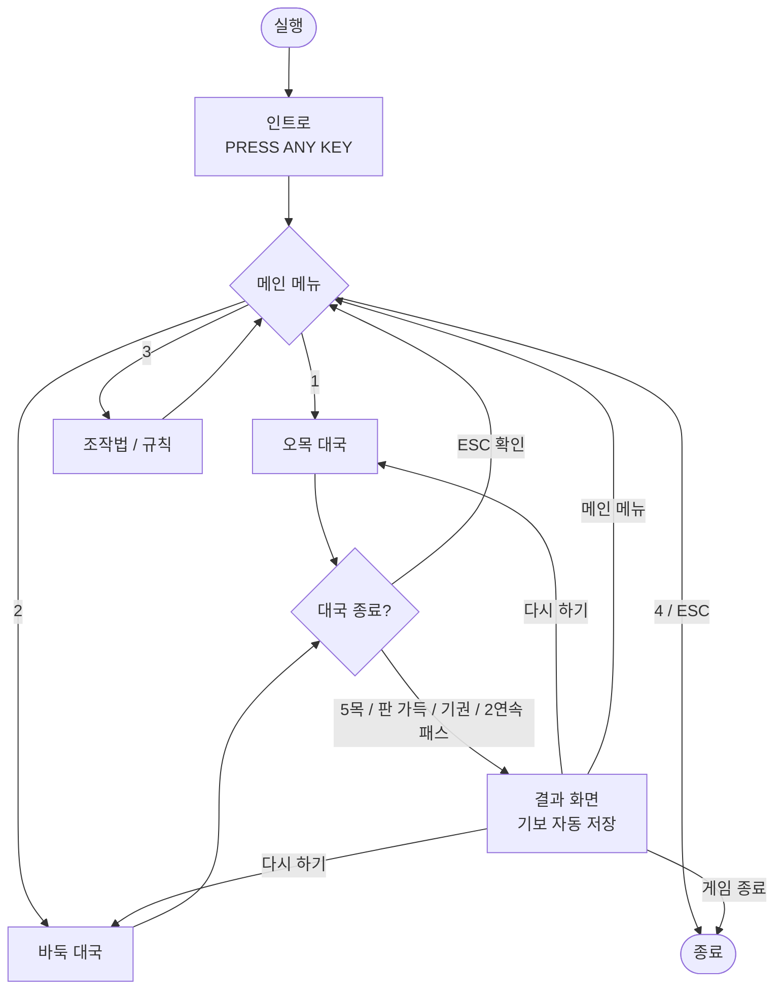

# 🚀 콘솔 바둑 & 오목 v2.0 — 업그레이드 내역

> 원본 코드(19×19 바둑판 착수 프로그램)를 **바둑과 오목을 모두 즐길 수 있는 게임**으로 업그레이드했습니다.
> 원본 분석은 [README.md](README.md)를 참고하세요.

---

## 목차

1. [업그레이드 요약](#1-업그레이드-요약)
2. [업그레이드 항목 (35점)](#2-업그레이드-항목-35점)
3. [화면 구성](#3-화면-구성)
4. [조작법](#4-조작법)
5. [게임 규칙](#5-게임-규칙)
6. [코드 구조](#6-코드-구조)
7. [핵심 알고리즘](#7-핵심-알고리즘)
8. [빌드 및 실행 방법](#8-빌드-및-실행-방법)
9. [테스트 내역](#9-테스트-내역)
10. [알려진 제한 사항](#10-알려진-제한-사항)

---

## 1. 업그레이드 요약

| 구분 | 원본 | v2.0 |
|---|---|---|
| 게임 종류 | 착수만 가능 | **오목 / 바둑** 선택 |
| 승패 판정 | 없음 | 오목 5목 판정, 바둑 따내기·계가 |
| 시작 화면 | 없음 | 인트로 → 메인 메뉴 |
| 종료 화면 | 없음 (ESC 즉시 종료) | 결과 화면 + 다시하기/메인메뉴/종료 |
| 화면 갱신 | 매 입력마다 판 전체 재출력 | **바뀐 칸만** 다시 그림 (깜빡임 없음) |
| 잘못된 착수 | 겹쳐 놓기 가능 | 중복·자충수·패 금지 |
| 코드 규모 | 123줄, 함수 6개 | 1,123줄, 함수 42개 |

---

## 2. 업그레이드 항목 (35점)

> 같은 종류의 변경은 1점으로만 계산했습니다. 목표 30점, 달성 **35점**.

### 🎬 인트로 · 메뉴 · 흐름 (5점)

| # | 항목 | 설명 | 관련 함수 |
|:-:|---|---|---|
| 1 | 인트로 타이틀 화면 | `■` 문자로 그린 BADUK & OMOK 배너, PRESS ANY KEY 깜빡임 | `show_intro`, `print_banner` |
| 2 | 게임 모드 선택 메뉴 | 오목 / 바둑 / 조작법 / 종료 중 선택 (방향키 또는 숫자키) | `main_menu`, `select_menu` |
| 3 | 조작법·규칙 도움말 화면 | 메뉴 또는 대국 중 `H` 키로 열람 | `show_help` |
| 4 | 다시하기 / 메인메뉴 / 종료 선택 | 대국이 끝나면 다음 행동을 고를 수 있음 | `show_result` |
| 5 | 콘솔 창 제목·크기 설정 | 제목 "콘솔 바둑 & 오목 v2.0", 90×32 고정 | `setup_console` |

### ⚫ 오목 규칙 (4점)

| # | 항목 | 설명 | 관련 함수 |
|:-:|---|---|---|
| 6 | 5목 승리 판정 | 가로·세로·대각선 2방향, 총 4방향 검사 | `check_omok` |
| 7 | 장목(6목 이상) 불인정 | 정확히 5개일 때만 승리 | `check_omok` |
| 8 | 승리 5목 하이라이트 | 이긴 5개의 돌을 연두색 배경으로 표시 | `winMark`, `draw_cell` |
| 9 | 무승부 판정 | 361칸이 모두 차면 무승부 | `play_omok` |

### ⚪ 바둑 규칙 (7점)

| # | 항목 | 설명 | 관련 함수 |
|:-:|---|---|---|
| 10 | 돌 따내기 | 활로가 0인 상대 무리를 판에서 제거 | `play_go`, `collect_group` |
| 11 | 자충수 금지 | 따내는 경우가 아니면 활로 0인 자리에 착수 불가 | `play_go` |
| 12 | 패(ko) 규칙 | 한 점을 따낸 직후 그 자리를 바로 되따낼 수 없음 | `play_go` |
| 13 | 따낸 돌(사석) 수 표시 | 흑·백 각각 정보 패널에 표시 | `draw_panel` |
| 14 | 패스 & 종국 | `P` 키로 패스, 연속 2번 패스 시 대국 종료 | `do_pass` |
| 15 | 계가 + 덤 | 중국식 영역 계가, 백 덤 6.5집 | `score_go` |
| 16 | 기권 | `R` 키, Y/N 확인 후 상대 승리 | `play_game`, `confirm` |

### 🏆 승패 · 정보 표시 (5점)

| # | 항목 | 설명 | 관련 함수 |
|:-:|---|---|---|
| 17 | 승패 결과 화면 | 승자, 승리 사유, 계가 상세, 총 수, 전적 표시 | `show_result` |
| 18 | 현재 차례 표시 | "차례 ● 흑 / ○ 백" | `draw_panel` |
| 19 | 수순 표시 | 지금까지 진행된 수 | `draw_panel` |
| 20 | 마지막 착수 위치 표시 | 판 위에 `◆`로 표시 + 패널에 좌표(예: K10) | `draw_cell`, `draw_panel` |
| 21 | 전적 누적 | 프로그램 실행 동안 흑·백 승수와 무승부 수 누적 | `wins`, `draws` |

### 🐞 원본 버그 수정 (3점)

| # | 항목 | 원본 문제 | 해결 |
|:-:|---|---|---|
| 22 | 중복 착수 금지 | 돌 위에 또 둘 수 있었음 | 빈 칸 검사 후 경고 메시지 |
| 23 | 흑 선공 | 백(○)이 먼저 뒀음 | `g.turn = BLACK`으로 시작 |
| 24 | 방향키 확장 코드 처리 | 224 접두값 미처리, `H`·`K`·`M`·`P` 키로 커서 이동 | `get_key()`에서 두 바이트를 읽어 정규화 |

### 🎨 화면 · 조작 개선 (9점)

| # | 항목 | 설명 | 관련 함수 |
|:-:|---|---|---|
| 25 | 깜빡임 제거 | 셀 상태 캐시(`shown`)와 비교해 바뀐 칸만 다시 그림 | `refresh_board` |
| 26 | 콘솔 커서 숨기기 | 깜빡이는 밑줄 커서 제거 | `hide_cursor` |
| 27 | 색상 적용 | 황토색 판, 흑·백 돌 색, 메뉴 선택 반전, 경고 빨강 등 | `set_color` |
| 28 | 좌표 라벨 | 위·아래 A~T(I 제외), 좌·우 19~1 | `draw_labels` |
| 29 | 화점 표시 | 9개 화점을 `╋`로 표시 | `grid_char` |
| 30 | 무르기 (Undo) | `U` 키로 한 수씩 되돌리기 (따낸 돌·패 상태까지 복원) | `do_undo`, `push_history` |
| 31 | WASD 이동 | 방향키와 동일하게 동작 | `get_key` |
| 32 | 효과음 | 착수, 오류, 메뉴 선택, 승리 팡파르, 무승부 | `snd_*` |
| 33 | 폰트 변경 | 콘솔 글꼴을 굴림체 20px로 설정 | `setup_console` |

### 🧹 코드 품질 · 부가 기능 (2점)

| # | 항목 | 설명 |
|:-:|---|---|
| 34 | 코드 구조 개선 | 매직 넘버 상수화, `matrix[2][20][20]` → `board[19][19]` 단일 배열, `GameState` 구조체, `exit()` 제거 |
| 35 | 기보 파일 저장 | 대국이 끝나면 `kifu_날짜_시간.txt`로 전체 수순과 결과를 자동 저장 |

---

## 3. 화면 구성

### 3.1 화면 흐름



### 3.2 대국 화면 배치

```
   A B C D E F G H J K L M N O P Q R S T
19 ┌┬┬┬┬┬┬┬┬┬┬┬┬┬┬┬┬┬┐ 19     [  바  둑  ]
18 ├┼┼┼┼┼┼┼┼┼┼┼┼┼┼┼┼┼┤ 18
17 ├┼┼┼┼┼┼┼┼┼┼┼┼┼┼┼┼┼┤ 17     차례       ○ 백
16 ├┼┼╋┼┼┼┼┼╋┼┼┼┼┼╋┼┼┤ 16     진행       12수
 :          ...                마지막 수  흑 K10
10 ├┼┼╋┼┼┼┼┼◆┼┼┼┼┼╋┼┼┤ 10
 :          ...                따낸 돌    흑 1  /  백 0
 1 └┴┴┴┴┴┴┴┴┴┴┴┴┴┴┴┴┴┘ 1      덤         백 6.5집
   A B C D E F G H J K L M N O P Q R S T
                                전적       흑 0승  백 0승  무 0
  (안내 메시지 줄)
```

| 영역 | 위치 | 내용 |
|---|---|---|
| 좌표 라벨 | 판 상하좌우 | A~T (I 생략), 19~1 |
| 바둑판 | 열 5~42, 행 3~21 | 19×19 |
| 정보 패널 | 열 49~ | 모드, 차례, 수순, 마지막 수, 사석, 덤, 전적, 조작키 |
| 메시지 줄 | 25행 | 오류·안내·확인 질문 |

### 3.3 판 위 기호

| 기호 | 의미 |
|---|---|
| `●` (검정) | 흑돌 |
| `●` (흰색) | 백돌 |
| `◆` | 마지막에 놓인 돌 (색은 해당 돌 색) |
| `◎` | 커서 (색은 현재 차례 색) |
| 빨간 배경 | 돌 위에 커서가 있을 때 |
| 연두 배경 | 오목에서 승리한 5목 |
| `╋` | 화점 |

---

## 4. 조작법

| 키 | 동작 | 모드 |
|---|---|---|
| `↑` `↓` `←` `→` / `W` `A` `S` `D` | 커서 이동 | 공통 |
| `Space` / `Enter` | 돌 놓기, 메뉴 선택 | 공통 |
| `1` ~ `4` | 메뉴 바로 선택 | 메뉴 |
| `U` | 무르기 | 공통 |
| `P` | 패스 | 바둑 |
| `R` | 기권 | 공통 |
| `H` | 도움말 | 공통 |
| `ESC` | 메인 메뉴로 (확인 후) | 공통 |

---

## 5. 게임 규칙

### 오목

- 흑이 먼저 둡니다.
- 가로·세로·대각선으로 **정확히 5개**를 먼저 이으면 승리합니다.
- 6개 이상 이어진 **장목은 승리로 인정하지 않습니다.**
- 361칸이 모두 차면 무승부입니다.

### 바둑

- 흑이 먼저 두고, 백은 **덤 6.5집**을 받습니다.
- 상대 무리의 활로(상하좌우로 이웃한 빈 칸)를 모두 막으면 따냅니다.
- 놓자마자 내 돌이 잡히는 자리(**자충수**)에는 둘 수 없습니다. 단, 그 수로 상대를 따내면 둘 수 있습니다.
- **패**: 한 점을 따낸 직후, 상대는 그 자리를 곧바로 되따낼 수 없습니다.
- 두 사람이 **연속으로 패스**하면 대국이 끝나고 계가합니다.
- **계가(중국식 영역 계가)**: 판 위의 내 돌 수 + 내 돌로만 둘러싸인 빈 칸 수.

---

## 6. 코드 구조

### 6.1 함수 호출 구조

```
main
 ├─ setup_console        코드 페이지, 제목, 폰트, 창 크기, 커서 숨김
 ├─ show_intro           배너 + PRESS ANY KEY
 └─ main_menu ── select_menu
     ├─ show_help
     └─ play_game ─────────────────────────── 대국 루프
         ├─ init_game / redraw_all
         ├─ refresh_board ── cell_visual, draw_cell, grid_char
         ├─ draw_panel ── panel_line, coord_str
         ├─ get_key
         ├─ play_omok ── check_omok
         ├─ play_go ── collect_group
         ├─ do_pass ── score_go
         ├─ do_undo / push_history
         ├─ confirm
         └─ show_result ── save_kifu, select_menu
```

### 6.2 핵심 자료구조

```c
typedef struct {
    int board[N][N];     // board[y][x] = EMPTY(0) / BLACK(1) / WHITE(2)
    int turn;            // 현재 차례
    int moveNo;          // 진행된 수 (패스 포함)
    int captured[3];     // captured[c] = c가 따낸 돌 수
    int lastX, lastY;    // 마지막 착수 위치
    int koX, koY;        // 패로 금지된 자리
    int passCount;       // 연속 패스 횟수
} GameState;
```

- 게임의 모든 상태를 구조체 하나에 담아, **무르기는 구조체를 통째로 복사·복원**하는 방식으로 단순하게 구현했습니다.
- 원본의 `matrix[2][20][20]`(플레이어별 층)을 `board[19][19]` 하나로 합쳐 한 칸의 상태를 바로 알 수 있습니다.

### 6.3 원본 대비 좌표계 변화

| 구분 | 원본 | v2.0 |
|---|---|---|
| 커서 좌표 | 화면 열(1, 3, …, 37) | **배열 인덱스(0~18)** |
| 화면 변환 | `(x+1)/2`, `x*2-1` | `BOARD_X + x*2`, `BOARD_Y + y` |
| 배열 인덱스 | 1~19 (0 미사용) | 0~18 |

---

## 7. 핵심 알고리즘

### 7.1 깜빡임 제거 — 셀 상태 캐시

각 칸의 "보이는 상태"를 정수 하나로 인코딩하고, 이전에 그린 값과 다를 때만 다시 그립니다.

| 비트 | 의미 |
|---|---|
| 0–1 | 돌 (빈칸 / 흑 / 백) |
| 2 | 마지막 착수 |
| 3 | 커서 |
| 4 | 승리 5목 |
| 5–6 | 커서가 있을 때 현재 차례 |

커서를 한 칸 움직이면 **이전 칸과 새 칸, 2칸만** 다시 그립니다. 원본은 매번 19줄 전체를 출력했습니다.

### 7.2 오목 5목 판정

1. 방금 놓은 돌에서 4방향(→, ↓, ↘, ↗) 각각에 대해
2. 반대 방향으로 끝까지 가서 시작점을 찾고
3. 정방향으로 같은 색 돌을 셉니다.
4. 개수가 **정확히 5**이면 승리, 해당 5칸을 `winMark`에 표시합니다.

### 7.3 바둑 따내기 — 무리 탐색 (DFS)

```
collect_group(x, y):
    스택에 (x, y) 넣기
    스택이 빌 때까지:
        꺼낸 칸을 무리에 추가
        상하좌우 이웃이
            빈 칸   → 활로로 기록 (중복 제외)
            같은 색 → 방문 안 했으면 스택에 추가
    return 활로 수
```

착수 처리 순서:

1. 빈 칸인지, 패 금지 자리인지 확인
2. 돌을 놓음
3. 이웃한 **상대 무리**의 활로가 0이면 제거
4. **내 무리**의 활로가 0이면 자충수 → 착수 취소
5. 정확히 1점을 따냈고, 내 돌이 홀로 활로 1개뿐이면 그 자리를 **패 금지점**으로 지정

### 7.4 계가 — 빈 칸 영역 탐색

빈 칸 덩어리마다 탐색해서 테두리에 닿은 돌의 색을 확인합니다.

- 흑에만 닿음 → 흑 집
- 백에만 닿음 → 백 집
- 둘 다 닿음 / 아무것도 안 닿음 → 중립

`흑 점수 = 흑 돌 + 흑 집`, `백 점수 = 백 돌 + 백 집 + 6.5`

---

## 8. 빌드 및 실행 방법

### 8.1 파일 구성

| 파일 | 인코딩 | 용도 |
|---|---|---|
| `baduk_omok.c` | **CP949** | 컴파일용 소스 (원본과 같은 인코딩) |
| `baduk_omok_utf8.c` | UTF-8 | GitHub에서 읽기용 (내용 동일) |

### 8.2 Visual Studio

1. 빈 프로젝트(콘솔 앱) 생성
2. `baduk_omok.c`를 소스 파일에 추가
3. 빌드 후 실행 (`Ctrl + F5`)

> 한국어 Windows에서는 CP949 소스를 그대로 인식합니다.

### 8.3 Dev-C++ / MinGW

```bash
gcc -std=c99 baduk_omok.c -o baduk_omok.exe
```

### 8.4 실행 환경 주의

- **기본 콘솔 창(conhost)**에서 실행하세요. Windows 11의 Windows Terminal은 괘선 문자를 반각으로 그려 판이 어긋날 수 있습니다.
  - 설정 → 시작 → 기본 터미널 애플리케이션 → **Windows 콘솔 호스트**
- 폰트·창 크기 설정도 기본 콘솔 창에서만 적용됩니다.

### 8.5 GitHub에 올릴 때 (인코딩 팁)

CP949 파일은 GitHub 화면에서 한글이 깨져 보입니다. 저장소 최상위에 `.gitattributes`를 두면, 저장소에는 UTF-8로 보관하고 내려받을 때 CP949로 바꿔 줍니다.

```gitattributes
*.c working-tree-encoding=CP949 eol=crlf
```

---

## 9. 테스트 내역

Windows 콘솔 API를 대체 함수로 바꿔 Linux에서 컴파일하고, 규칙 로직을 자동 테스트했습니다.

| 분류 | 테스트 | 결과 |
|---|---|---|
| 컴파일 | `gcc -std=c99 -Wall -Wextra -pedantic` | ✅ 경고 0 |
| 오목 | 가로 5목 승리 | ✅ |
| 오목 | 대각선(↗) 5목 승리 | ✅ |
| 오목 | 6목(장목) 불인정 | ✅ |
| 오목 | 판 가장자리 세로 5목 | ✅ |
| 공통 | 중복 착수 거부 | ✅ |
| 바둑 | 한 점 따내기 | ✅ |
| 바둑 | 귀(모서리) 따내기 | ✅ |
| 바둑 | 두 점 무리 따내기 | ✅ |
| 바둑 | 자충수 거부 | ✅ |
| 바둑 | 패: 즉시 되따기 거부 → 다른 곳 착수 후 허용 | ✅ |
| 바둑 | 빈 판 2연속 패스 → 백 덤승 | ✅ |
| 바둑 | 영역 계가 (흑 10줄 vs 백 9줄 → 흑 12.5집 승) | ✅ |
| 공통 | 무르기 후 상태 복원 | ✅ |
| 흐름 | 인트로 → 오목 승리 → 메인 메뉴 → 바둑 계가 → 종료, 기보 저장 | ✅ |

> 실제 화면 출력(색상, 폰트, 괘선 정렬)은 Windows 환경에서 확인이 필요합니다.

---

## 10. 알려진 제한 사항

| 항목 | 내용 |
|---|---|
| 바둑 사석 판정 | 죽은 돌을 자동으로 판정하지 않습니다. 계가 전에 직접 따내야 정확합니다. |
| 오목 렌주룰 | 흑의 3-3, 4-4 금수는 적용하지 않았습니다 (장목만 불인정). |
| 슈퍼 패 | 같은 판 모양 반복(삼패 등)은 검사하지 않고, 기본 패만 처리합니다. |
| 전적 저장 | 프로그램을 끄면 전적이 초기화됩니다. |
| 기보 파일명 | 같은 초에 두 대국이 끝나면 파일명이 겹칠 수 있습니다. |
